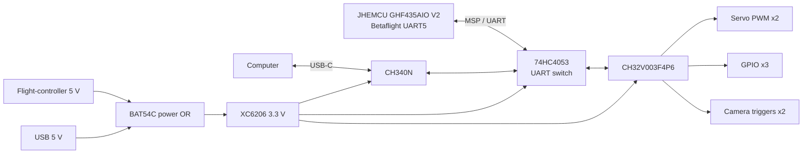
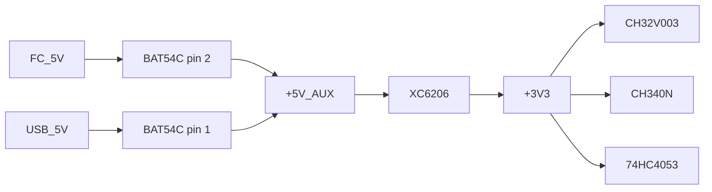

# KEPLER V - Auxiliary Control Module

[English](README.md) | [简体中文](README.zh-CN.md)

KEPLER V Auxiliary Control Module is a small companion board for FPV aircraft. It reads MSP data from the flight controller, then handles servos, low-speed GPIO, camera triggers, and USB configuration without touching the flight controller's attitude loop.

The V1 board is built around a CH32V003F4P6. It measures 25.000 mm by 26.016 mm, uses four layers, and keeps every active part in a package that can be soldered by hand.

This repository contains the schematic, PCB source, previews, datasheets, and design notes for reviewing or building V1. Firmware is separate.

> This is experimental open hardware. It is not a flight controller, a BEC, or a certified aviation product. Read [Safety and scope](#safety-and-scope) before applying power or installing it on an aircraft.


## Project status

| Item | V1 status |
|---|---|
| Schematic | Complete and read back from EasyEDA |
| PCB | Complete, routed, and copper-filled |
| Outline | 25.000 mm x 26.016 mm |
| Stackup | 4 layers |
| Native DRC | 0 violations |
| Extended DFM | 0 errors, 64 warnings |
| Firmware | Not included |
| Flight testing | Not performed |
| License | MIT |

A clean DRC result only means the board passed the checks that were run. It does not prove the circuit, assembly, or aircraft installation is safe.

## What the board does

The flight controller remains responsible for stabilization. The auxiliary board takes pressure off its spare UART and GPIO by handling slower, separate tasks.

- One UART/MSP link to the flight controller.
- Two hardware-timer servo PWM outputs.
- Three 3.3 V GPIO outputs.
- Two active-low camera triggers for video and still photos.
- A USB-C configuration port with an onboard CH340N.
- Automatic UART switching between the flight controller and the computer.
- A SWIO/NRST header for programming and recovery.

The UART switching was added because the MCU has one useful UART. A laptop can change macros or parameters through USB, then the same UART returns to the flight controller when USB is removed.

## Board interfaces

| Connector | Purpose | Signals |
|---|---|---|
| J1 | Flight-controller UART and logic power | `FC_5V`, `GND`, `FC_UART5_TX`, `FC_UART5_RX` |
| J2 | Servo 1 signal | `SERVO1_PWM`, `GND` |
| J3 | Servo 2 signal | `SERVO2_PWM`, `GND` |
| J4 | General-purpose GPIO | `GPIO1`, `GPIO2`, `GPIO3`, `GND` |
| J5 | Camera module triggers | `DVR_AVI_N`, `DVR_JPG_N`, `GND` |
| J6 | Programming and debug | `+3V3`, `GND`, `SWIO`, `NRST` |
| J7 | USB-C configuration | `VBUS`, `D-`, `D+`, `CC1/CC2`, `GND` |

J1 through J6 are direct-solder pads on a 2.54 mm pitch. Each footprint contains only plated through holes, with no pin header, socket, plastic body, or header 3D model. Servo current comes from a separate BEC and must never load the board's 3.3 V regulator.

The top silkscreen names each solder pad with a short net label, such as `U5TX`, `SERVO1`, `AVI`, or `SWIO`. The labels use the pad position itself as the placement guide, so the harness can be checked without opening the schematic.

## System architecture



### Automatic UART routing

When USB power is present, a resistor divider drives `USB_SEL` high and the 74HC4053 connects the MCU UART to the CH340. With USB removed, the selector returns low and the UART goes back to the flight controller.

| `USB_SEL` | UART peer | Operating mode |
|---|---|---|
| High | CH340N | Configuration and macros |
| Low | Flight-controller UART5 | Flight operation and MSP polling |

The selector voltage also reaches PD3. Firmware reads it as high impedance. MSP polling stops once firmware enters the USB configuration mode and starts listening for commands.

## Key parts

| Ref | Part | Function | Package | LCSC |
|---|---|---|---|---|
| U1 | CH32V003F4P6 | Main MCU | TSSOP-20 | C5187096 |
| U2 | XC6206P332MR-G | 5 V to 3.3 V LDO | SOT-23-3 | C2891264 |
| U3 | CH340N | USB to UART | SOP-8 | C2977777 |
| U4 | 74HC4053D118 | UART 2:1 switch | SOIC-16 | C3657152 |
| D1 | KT-0603R | Status LED | 0603 | C2286 |
| D2 | USBLC6-2SC6 | USB ESD protection | SOT-23-6 | C2687116 |
| D3 | BAT54C,215 | 5 V power OR | SOT-23-3 | C24385835 |
| J7 | TYPE-C-31-M-12 | USB-C receptacle | SMD | C165948 |

The [datasheet index](doc/03-器件Datasheet.md) lists exact vendor revisions and checksums.

## MCU pinout

| Pin | Port | Net | Function |
|---:|---|---|---|
| 1 | PD4 | `STATUS_LED_N` | Status LED, active low |
| 2 | PD5 | `MCU_TX` | UART transmit |
| 3 | PD6 | `MCU_RX` | UART receive |
| 4 | PD7/NRST | `NRST` | Reset and debug |
| 5 | PA1 | `GPIO1` | 3.3 V GPIO |
| 6 | PA2 | `GPIO2` | 3.3 V GPIO |
| 7 | VSS | `GND` | Ground |
| 8 | PD0 | NC | Unused |
| 9 | VDD | `+3V3` | Supply |
| 10 | PC0 | `GPIO3` | 3.3 V GPIO |
| 11 | PC1 | `DVR_AVI_N` | Video trigger, 5 V tolerant open drain |
| 12 | PC2 | NC | Unused |
| 13 | PC3 | `SERVO1_MCU` | TIM1_CH3 PWM |
| 14 | PC4 | `SERVO2_MCU` | TIM1_CH4 PWM |
| 15 | PC5 | `DVR_JPG_N` | Photo trigger, 5 V tolerant open drain |
| 16 | PC6 | NC | Unused |
| 17 | PC7 | NC | Unused |
| 18 | PD1 | `SWIO` | Single-wire programming and debug |
| 19 | PD2 | NC | Unused |
| 20 | PD3 | `USB_SEL` | USB detection input |

## Power path



Flight-controller 5 V supplies the logic board and its 3.3 V regulator, while servo and camera loads stay on separate paths. Every connected device still needs a common ground.

The BAT54C limits back-feed. It does not replace a reverse-polarity protection stage, an input fuse, or a complete power switch.

USB-C CC1 and CC2 each connect through a 5.1 kOhm pulldown resistor, so the port presents itself as a USB 2.0 sink to the host.

## PCB

### Top


### Bottom


### Stackup

| Layer | Use |
|---|---|
| Top | Main parts, USB, wire pads, and top-side routing |
| Inner1 | Solid GND pour |
| Inner2 | Solid +3V3 pour |
| Bottom | MCU, CH340, 74HC4053, and bottom-side routing |

### Fabrication settings

| Setting | V1 value |
|---|---|
| Outline | 25.000 mm x 26.016 mm |
| Layers | 4 |
| Thickness | 1.6 mm |
| Signal width and clearance | 6 mil |
| Rule near the USB-C slot | 8 mil |
| Surface finish | Leaded HASL for the current order |
| Controlled impedance | None, USB Full-Speed over a short path |
| Pin headers | Not fitted, J1 through J6 are solder pads |

The images are for review. Gerber, BOM, CPL, and raw DRC/DFM reports stay local. Git ignores the `outputs/` directory.

## Repository layout

```text
.
|-- README.md
|-- README.zh-CN.md
|-- LICENSE
|-- assets/
|   |-- datasheets/
|   `-- images/
|-- doc/
|   |-- 01-原理图设计说明.md
|   |-- 02-PCB布线与制造检查.md
|   `-- 03-器件Datasheet.md
|-- source/
|   `-- easyeda/
|       `-- kepler-v-acm-v1.epro2
`-- outputs/              # local generated files, ignored by Git
```

## Open and edit

1. Install EasyEDA Pro. V1 was last saved with version 4.1.78.
2. Open [source/easyeda/kepler-v-acm-v1.epro2](source/easyeda/kepler-v-acm-v1.epro2).
3. Open the `Control` schematic page and `PCB1`.
4. Run schematic checks after any netlist change.
5. Run PCB DRC and DFM checks after any layout change.
6. Regenerate Gerber, BOM, and CPL files before ordering.

The EasyEDA archive passed its ZIP integrity check and the exported file has a stable SHA-256 hash. It has not been imported into a fresh project, so a reviewer should reopen it and verify both documents before producing boards.

## Firmware contract

Firmware lives elsewhere. The hardware makes a few assumptions that firmware must preserve.

- Servo PWM runs from a hardware timer and keeps its last valid output between MSP responses.
- PD3 stays a high-impedance input. Firmware must not drive the `USB_SEL` divider.
- PC1 and PC5 are open-drain outputs. Each trigger returns high after a bounded low pulse.
- USB mode stops flight-controller polling and switches to the CH340 command protocol.
- A UART timeout, invalid data, or a disarmed state sends the servos to a predefined safe position.
- Macro and parameter writes use paged Flash storage with wear tracking and interrupted-write recovery.
- A timeout must not toggle camera triggers or GPIOs without an explicit rule.

Suggested firmware modules:

```text
app
|-- uart_msp
|-- flight_state
|-- servo
|-- gpio
|-- dvr_trigger
|-- usb_config
|-- macros
`-- safety
```

## Build and assembly

1. Export a fresh Gerber, BOM, and CPL from EasyEDA.
2. Check the four copper layers, GND and +3V3 pours, drill file, board outline, and USB-C slot in the fabricator preview.
3. Review every DFM warning that can affect solder joints, exposed copper, or component clearance.
4. Send only SMT references to the assembly service. J1 through J6 are wire holes and should not appear in the CPL.
5. Inspect bridges, polarity marks, USB-C anchor joints, and fine-pitch pins on arrival.

## First power-up

1. Leave the flight controller, servos, and camera disconnected. Check for shorts between 5 V and GND and between 3.3 V and GND.
2. Use a current-limited supply on `FC_5V`. Confirm the 3.3 V rail and note the idle current.
3. Measure `USB_SEL` with USB inserted and removed.
4. Connect a WCH-LinkE to J6 and verify SWIO, NRST, target power, and firmware download.
5. Check UART routing and CH340 enumeration before attaching any actuator.
6. Inspect both PWM outputs with a scope or logic analyzer, including the power-up position.
7. Add the camera module and servos one at a time. Unplug the flight-controller UART and confirm that the outputs enter their defined safe state.

## Verification and open issues

The V1 netlist and PCB have passed the checks listed above. The extended DFM report still has 64 warnings. Most are designator boxes crossing pad envelopes, short parallel runs below the 3W heuristic, a few non-ideal trace angles, and narrow sections on the auxiliary 5 V path.

No EMC, surge, thermal, vibration, or flight tests have been completed. The CH340N runs at USB Full-Speed, so this design avoids the stricter impedance, length matching, and routing rules used for High-Speed links.

The board has no servo power switch, current monitor, or external watchdog. During an MCU reset or board power loss, servo behavior depends on the servo and its separate BEC.

## Safety and scope

This board does not replace the flight controller. The auxiliary MCU handles peripheral tasks. Attitude estimation, motor mixing, and the aircraft's primary failsafe logic stay in Betaflight.

Use these rules for any aircraft test:

- The aircraft must remain controllable if the auxiliary board loses power or stops responding.
- Every servo and camera output needs a defined safe state.
- Remove propellers for bench testing and use a current-limited supply.
- Inspect the generated manufacturing files before placing an order.
- Do not use this project in crewed, medical, firefighting, rescue, or other safety-critical systems.

## Contributing

Issues, design reviews, firmware ports, bench results, and layout fixes are welcome. Include the revision, EasyEDA version, and DRC/DFM result.

Keep local clutter out of pull requests. A new part needs its exact code, package, manufacturer, LCSC number, and datasheet source.

## License

The original design uses the [MIT License](LICENSE).

Third-party files keep their own terms. The MIT license does not apply to vendor datasheets, trademarks, or manufacturer-owned documentation.
