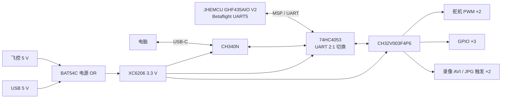
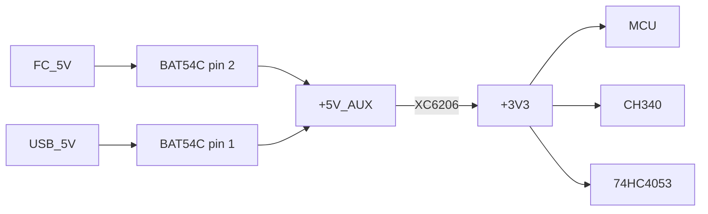

# KEPLER V — Auxiliary Control Module

KEPLER V Auxiliary Control Module（KEPLER V ACM）是一块面向 FPV 应用的轻量级辅助控制板。它通过 UART / MSP 与飞控通信，在独立的 CH32V003 上完成舵机 PWM、低速 GPIO、录像模块触发和 USB 在线配置，不参与飞控自身的姿态稳定环。

项目采用 EasyEDA Pro 设计，目标是把原本分散的辅助控制、录像控制和配置接口收敛到一块可以使用常规工具手焊的小型四层板上。

> 这是一项实验性开源硬件项目，不是飞控、BEC、安全关键设备或经适航认证的航空电子设备。首次上电和装机测试前请阅读[安全与使用边界](#安全与使用边界)。


## 当前状态

| 项目 | 状态 |
|---|---|
| 原理图 | V1 完成，已保存并回读 |
| PCB | V1 完成，已布线并铺铜 |
| 板框尺寸 | `25.000 mm × 26.016 mm` |
| 层数 | 4 层 |
| 原生 DRC | 0 violation |
| 扩展 DFM | 0 error，64 warning |
| 固件 | 尚未包含在本仓库，接口和引脚已经固定 |
| 实机飞行 | 尚未验证 |
| 许可证 | MIT |

当前版本优先解决硬件接口和板级验证，不应把“DRC 通过”理解为电路、装配或飞行安全已经得到验证。

## 功能概览

- CH32V003F4P6 低成本 RISC-V MCU。
- UART / MSP 通道从飞控读取 RC、ARM、飞行模式、电压和链路质量等数据。
- 2 路独立舵机 PWM 信号。
- 3 路 3.3 V 逻辑 GPIO。
- 2 路录像模块低电平触发：录像 `AVI` 和拍照 `JPG`。
- 板载 USB-C 和 CH340N，可直接连接电脑修改参数或编写控制宏。
- USB 插入时自动把 MCU UART 从飞控切换到 CH340；拔出后恢复飞控 MSP 通道。
- 飞控 5 V 与 USB 5 V 通过 BAT54C 做电源 OR，降低反灌风险。
- 保留 `3V3 / GND / SWIO / NRST` 烧录调试焊盘。
- 主要接口使用 2.54 mm 通孔焊盘直接焊线，不要求安装排针。
- 所有有源器件均使用 TSSOP、SOP、SOIC 或 SOT 封装，避免 LQFP、QFN、BGA。

## 接口总览

| 接口 | 用途 | 引脚 |
|---|---|---|
| J1 | 飞控 UART5 和逻辑电源 | `FC_5V`、`GND`、`FC_UART5_TX`、`FC_UART5_RX` |
| J2 | 舵机 1 信号 | `SERVO1_PWM`、`GND` |
| J3 | 舵机 2 信号 | `SERVO2_PWM`、`GND` |
| J4 | 通用 GPIO | `GPIO1`、`GPIO2`、`GPIO3`、`GND` |
| J5 | 录像模块 | `DVR_AVI_N`、`DVR_JPG_N`、`GND` |
| J6 | 烧录调试 | `+3V3`、`GND`、`SWIO`、`NRST` |
| J7 | USB-C 配置口 | `VBUS`、`D-`、`D+`、`CC1/CC2`、`GND` |

J1～J6 在 PCB 上是用于直接焊线的 2.54 mm 通孔焊盘，不安装排针。舵机电源必须由独立 BEC 提供，不要从本板 3.3 V 稳压器取电。

## 系统结构



### USB/UART 自动切换

USB 存在时，分压网络把 `USB_SEL` 拉高，74HC4053 将 MCU UART 接到 CH340；USB 拔出后，`USB_SEL` 由下拉电阻恢复为低，UART 回到飞控。

| `USB_SEL` | UART 对端 | 使用场景 |
|---|---|---|
| 高 | CH340N | 电脑在线配置、自定义宏 |
| 低 | 飞控 UART5 | 正常飞行、MSP 数据读取 |

`USB_SEL` 同时连接到 MCU 的 PD3 高阻输入。固件可以据此停止飞控轮询并进入配置模式。

## 关键器件

| 位号 | 型号 | 作用 | 封装 | LCSC |
|---|---|---|---|---|
| U1 | CH32V003F4P6 | 主控 MCU | TSSOP-20 | C5187096 |
| U2 | XC6206P332MR-G | 5 V 到 3.3 V LDO | SOT-23-3 | C2891264 |
| U3 | CH340N | USB 转 UART | SOP-8 | C2977777 |
| U4 | 74HC4053D118 | UART 2:1 切换 | SOIC-16 | C3657152 |
| D1 | KT-0603R | 状态 LED | 0603 | C2286 |
| D2 | USBLC6-2SC6 | USB D+/D- ESD 保护 | SOT-23-6 | C2687116 |
| D3 | BAT54C,215 | 5 V 电源 OR | SOT-23-3 | C24385835 |
| J7 | TYPE-C-31-M-12 | USB-C 插座 | SMT | C165948 |

数据手册和来源索引见 [doc/03-器件Datasheet.md](doc/03-器件Datasheet.md)。

## MCU 引脚

| 物理脚 | 端口 | 网络 | 功能 |
|---:|---|---|---|
| 1 | PD4 | `STATUS_LED_N` | 状态 LED，低电平点亮 |
| 2 | PD5 | `MCU_TX` | UART TX |
| 3 | PD6 | `MCU_RX` | UART RX |
| 4 | PD7/NRST | `NRST` | 复位和 SWIO 调试 |
| 5 | PA1 | `GPIO1` | 3.3 V GPIO |
| 6 | PA2 | `GPIO2` | 3.3 V GPIO |
| 7 | VSS | `GND` | 地 |
| 8 | PD0 | NC | 不使用 |
| 9 | VDD | `+3V3` | 电源 |
| 10 | PC0 | `GPIO3` | 3.3 V GPIO |
| 11 | PC1 | `DVR_AVI_N` | 录像触发，5 V 容忍开漏 |
| 12 | PC2 | NC | 不使用 |
| 13 | PC3 | `SERVO1_MCU` | TIM1_CH3 PWM |
| 14 | PC4 | `SERVO2_MCU` | TIM1_CH4 PWM |
| 15 | PC5 | `DVR_JPG_N` | 拍照触发，5 V 容忍开漏 |
| 16 | PC6 | NC | 不使用 |
| 17 | PC7 | NC | 不使用 |
| 18 | PD1 | `SWIO` | 单线烧录调试 |
| 19 | PD2 | NC | 不使用 |
| 20 | PD3 | `USB_SEL` | USB 检测，高电平表示配置模式 |

## 电源设计



- 飞控 5 V 只用于逻辑板和板载 3.3 V 稳压。
- 舵机和录像模块负载不经过本板 LDO。
- 所有外部设备必须共地。
- 5 V 电源 OR 可以降低飞控与 USB 之间的反灌风险，但不应把它当作完整电源保护或反极性保护。
- USB-C 的 CC1/CC2 各有 5.1 kΩ 下拉，作为 USB 2.0 sink 使用。

## PCB

### 顶层


### 底层


### 层叠

| 层 | 用途 |
|---|---|
| Top | 主要器件、USB、接口和顶层信号 |
| Inner1 | GND 完整覆铜 |
| Inner2 | +3V3 完整覆铜 |
| Bottom | MCU、CH340、74HC4053 和背面走线 |

### 制造参数

| 参数 | V1 取值 |
|---|---|
| 板框 | `25.000 × 26.016 mm` |
| 层数 | 4 |
| 板厚 | 1.6 mm |
| 最小信号线宽/间距 | 6 mil |
| USB-C 定位槽附近规则 | 8 mil |
| 表面处理 | 有铅喷锡，按当前采购方案 |
| 阻抗控制 | 无特殊要求，USB Full-Speed 短线连接 |
| 排针 | 不安装，J1～J6 直接焊线 |

公开的 `assets/images` 只用于阅读。生产 Gerber、CPL、BOM 和 DRC/DFM 原始 JSON 保存在本地 `outputs/`，并根据仓库规则排除于 Git 之外。

## 仓库结构

```text
.
├── README.md
├── LICENSE
├── assets/
│   ├── datasheets/       # 主要器件 PDF
│   └── images/           # 原理图与 PCB 预览
├── doc/
│   ├── 01-原理图设计说明.md
│   ├── 02-PCB布线与制造检查.md
│   └── 03-器件Datasheet.md
├── source/
│   └── easyeda/
│       └── kepler-v-acm-v1.epro2
└── outputs/              # 本地生成物，不提交
```

## 打开与编辑

1. 安装 EasyEDA Pro。当前设计最后保存于 `4.1.78`。
2. 打开 [source/easyeda/kepler-v-acm-v1.epro2](source/easyeda/kepler-v-acm-v1.epro2)。
3. 打开原理图页 `Control` 和 PCB 文档 `PCB1`。
4. 修改后分别运行原理图检查、PCB DRC 和 DFM 检查。
5. 制造前重新生成 Gerber、BOM 和 CPL，并人工检查预览。

## 固件接口约定

本仓库当前只包含硬件设计，固件需要遵循以下板级约定：

- 舵机 PWM 由硬件定时器持续输出，不依赖每次 MSP 响应。
- PD3 只配置为高阻输入，不能驱动 `USB_SEL` 分压节点。
- PC1/PC5 配置为开漏输出，录像触发脉冲结束后释放总线。
- 检测到 USB 配置模式后，停止飞控 MSP 轮询，切换到 CH340 命令协议。
- 飞控通信超时、数据无效或安全条件不满足时，舵机进入预先定义的安全位置。
- 自定义宏和参数先写内部 Flash；使用分页、磨损统计和掉电恢复，避免高频擦写。
- 通信超时不得导致录像触发或 GPIO 随机翻转。

建议固件模块：

```text
app
├── uart_msp
├── flight_state
├── servo
├── gpio
├── dvr_trigger
├── usb_config
├── macros
└── safety
```

## 制造与装配

建议流程：

1. 从 EasyEDA Pro 重新导出 Gerber、BOM 和 CPL。
2. 在 JLC/嘉立创预览中检查四层铜、GND/3V3 覆铜、钻孔、板框和 USB-C 定位槽。
3. 先确认 DFM warning 中是否有位号压焊盘、焊盘被阻焊覆盖或器件间距不足。
4. SMT 只提交贴片位号；J1～J6 是焊线孔，不应出现在贴片坐标中。
5. 收货后先用放大镜检查桥连、极性、USB-C 固定脚和细间距引脚。

## 首次上电

1. 不连接飞控、舵机和录像模块，先检查 5 V 与 GND、3.3 V 与 GND 是否短路。
2. 使用限流电源从 J1 的 `FC_5V` 焊盘供电，确认静态电流和 3.3 V 输出。
3. 测量 `USB_SEL` 在 USB 插入/拔出时的高低电平。
4. 使用 WCH-LinkE 连接 J6，验证 SWIO、NRST、供电和固件下载。
5. 不装螺旋桨、不接舵机负载，验证 UART 回环和 CH340 枚举。
6. 示波器或逻辑分析仪检查两路 PWM 周期、脉宽和中位位置。
7. 最后连接舵机和录像模块，逐个通道测试，并验证拔掉飞控串口后的安全状态。

## 验证范围与已知限制

- 原理图网络检查已完成。
- PCB 原生 DRC 为 0 violation。
- 扩展 DFM 仍有 64 个 warning，主要包括 23 个位号与焊盘包络相交、局部并行线小于 3W 启发式阈值、少量非理想角度和部分电源走线宽度。
- 没有完成实际板级 EMC、浪涌、热、振动和飞行测试。
- USB 是 CH340N Full-Speed 通道，不是 High-Speed，也没有 High-Speed 阻抗要求。
- 设计没有实现舵机电源开关、电流检测或独立看门狗芯片。
- 板卡掉电或 MCU 复位时，外部舵机是否安全取决于舵机本身和独立 BEC。

## 安全与使用边界

这个项目不能替代飞控。辅助 MCU 负责的是低层外设控制，不是姿态融合、电机混控或失效保护飞控逻辑。

使用时至少应遵守：

- 辅助板失效时，飞控必须仍能保持原有飞行控制。
- 舵机和录像模块必须有明确的失效安全位置。
- 首次测试必须卸桨并使用限流电源。
- 不得直接依据未验证的 Gerber 或 BOM 批量生产。
- 不得把本板用于载人、医疗、消防、救援或其他安全关键系统。

## 参与贡献

欢迎提交问题、设计审查、固件适配、测试记录和 Gerber/DFM 改进建议。提交前请：

- 说明修改针对哪个原理图页或 PCB 版本。
- 附上 EasyEDA 版本和 DRC/DFM 结果。
- 不提交 `outputs/`、`work/`、工具链、日志或个人路径。
- 新增器件时同时提供型号、封装、厂商、LCSC 编号和 Datasheet 来源。
- 严禁通过修改图形来掩盖未连接网络或未完成布线。

## 许可证

本项目的原创硬件设计、文档和源文件使用 [MIT License](LICENSE)。

第三方数据手册、商标、器件符号和厂商资料不属于本项目 MIT 重授权范围，其权利归相应制造商所有。

