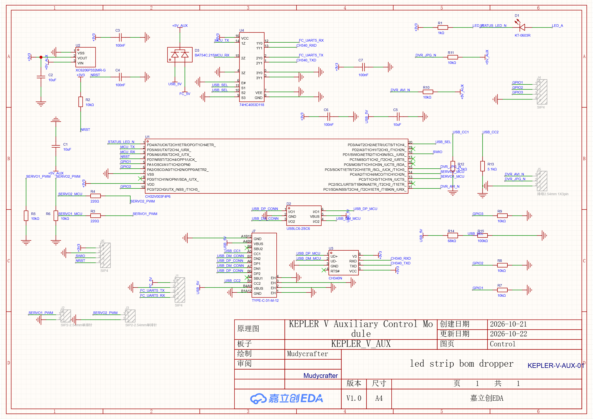
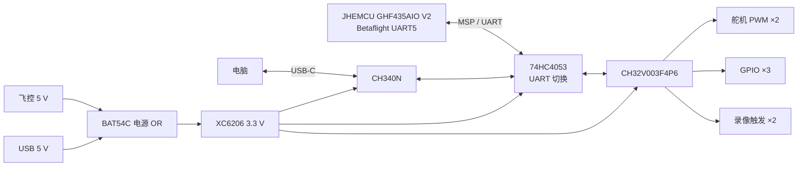
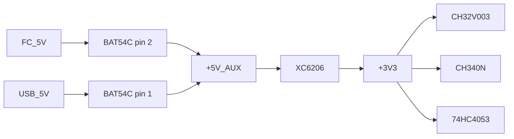
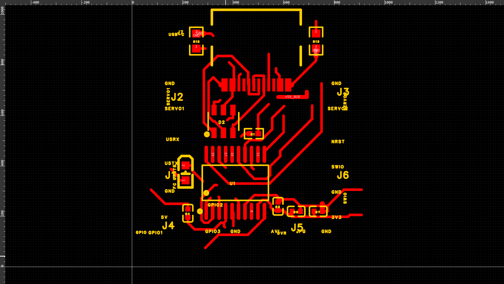
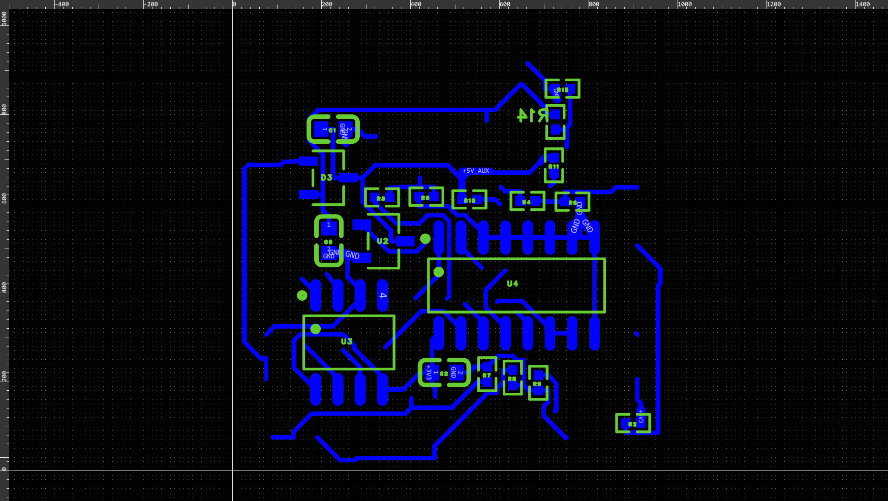

# KEPLER V - 辅助控制模块

[English](README.md) | [简体中文](README.zh-CN.md)

KEPLER V 辅助控制模块是一块面向 FPV 飞机的小型扩展板。它从飞控读取 MSP 数据，再独立处理舵机、低速 GPIO、录像触发和 USB 配置，不进入飞控的姿态控制环。

V1 使用 CH32V003F4P6，板框为 25.000 mm × 26.016 mm，四层结构。所有有源器件都采用可以用普通烙铁处理的小型封装。

仓库包含原理图、PCB 源文件、预览图、器件手册和审查记录。固件还没有放进这里。

> 这是一个实验性开源硬件项目。它不是飞控、BEC，也没有任何航空认证。上电或装到飞机上之前，请先读[安全与使用范围](#安全与使用范围)。



## 项目状态

| 项目 | V1 状态 |
|---|---|
| 原理图 | 已完成，并从 EasyEDA 回读 |
| PCB | 已完成布线并铺铜 |
| 板框 | 25.000 mm × 26.016 mm |
| 层数 | 4 层 |
| 原生 DRC | 0 violation |
| 扩展 DFM | 0 error，64 warning |
| 固件 | 尚未包含 |
| 飞行测试 | 尚未进行 |
| 许可证 | MIT |

DRC 结果干净，只表示当前规则没有报错。它不能证明电路、装配或装机后的飞机一定安全。

## 板子做什么

飞控继续负责增稳。辅助板接走一部分慢速、独立的外设任务，让飞控不必为每一个舵机和录像模块分配资源。

- 1 路连接飞控的 UART/MSP。
- 2 路由硬件定时器输出的舵机 PWM。
- 3 路 3.3 V GPIO。
- 2 路低电平触发的录像和拍照信号。
- 1 个带 CH340N 的 USB-C 配置口。
- USB 插入时自动切换 UART。
- 1 组 SWIO/NRST 烧录与恢复接口。

MCU 只有一路常用 UART，所以板子上加入了自动切换。电脑插上时可以修改宏和参数，拔掉后同一路 UART 回到飞控。

## 接口

| 接口 | 用途 | 信号 |
|---|---|---|
| J1 | 飞控 UART 和逻辑电源 | `FC_5V`、`GND`、`FC_UART5_TX`、`FC_UART5_RX` |
| J2 | 舵机 1 信号 | `SERVO1_PWM`、`GND` |
| J3 | 舵机 2 信号 | `SERVO2_PWM`、`GND` |
| J4 | 通用 GPIO | `GPIO1`、`GPIO2`、`GPIO3`、`GND` |
| J5 | 录像模块触发 | `DVR_AVI_N`、`DVR_JPG_N`、`GND` |
| J6 | 烧录调试 | `+3V3`、`GND`、`SWIO`、`NRST` |
| J7 | USB-C 配置 | `VBUS`、`D-`、`D+`、`CC1/CC2`、`GND` |

J1 到 J6 是 2.54 mm 通孔焊盘，直接焊线，不安装排针。舵机电源必须来自独立 BEC。板上的 3.3 V 稳压器不承担舵机电流。

## 系统结构



### UART 自动切换

插入 USB 后，电阻分压把 `USB_SEL` 拉高，74HC4053 把 MCU UART 接到 CH340。USB 拔出后，选择端回到低电平，UART 再接回飞控。

| `USB_SEL` | UART 对端 | 工作模式 |
|---|---|---|
| 高 | CH340N | 配置与宏编辑 |
| 低 | 飞控 UART5 | 飞行和 MSP 轮询 |

同一个选择电压还会送到 PD3。固件把它当作高阻输入。进入 USB 配置模式后，固件停止 MSP 轮询并开始等待命令。

## 主要器件

| 位号 | 型号 | 作用 | 封装 | LCSC |
|---|---|---|---|---|
| U1 | CH32V003F4P6 | 主控 | TSSOP-20 | C5187096 |
| U2 | XC6206P332MR-G | 5 V 转 3.3 V | SOT-23-3 | C2891264 |
| U3 | CH340N | USB 转 UART | SOP-8 | C2977777 |
| U4 | 74HC4053D118 | UART 2:1 切换 | SOIC-16 | C3657152 |
| D1 | KT-0603R | 状态灯 | 0603 | C2286 |
| D2 | USBLC6-2SC6 | USB ESD 保护 | SOT-23-6 | C2687116 |
| D3 | BAT54C,215 | 5 V 电源 OR | SOT-23-3 | C24385835 |
| J7 | TYPE-C-31-M-12 | USB-C 座 | SMD | C165948 |

准确的版本和校验值见[器件 Datasheet 索引](doc/03-器件Datasheet.md)。

## MCU 引脚

| 物理脚 | 端口 | 网络 | 功能 |
|---:|---|---|---|
| 1 | PD4 | `STATUS_LED_N` | 状态灯，低电平点亮 |
| 2 | PD5 | `MCU_TX` | UART 发送 |
| 3 | PD6 | `MCU_RX` | UART 接收 |
| 4 | PD7/NRST | `NRST` | 复位和调试 |
| 5 | PA1 | `GPIO1` | 3.3 V GPIO |
| 6 | PA2 | `GPIO2` | 3.3 V GPIO |
| 7 | VSS | `GND` | 地 |
| 8 | PD0 | NC | 不用 |
| 9 | VDD | `+3V3` | 电源 |
| 10 | PC0 | `GPIO3` | 3.3 V GPIO |
| 11 | PC1 | `DVR_AVI_N` | 录像触发，5 V 容忍开漏 |
| 12 | PC2 | NC | 不用 |
| 13 | PC3 | `SERVO1_MCU` | TIM1_CH3 PWM |
| 14 | PC4 | `SERVO2_MCU` | TIM1_CH4 PWM |
| 15 | PC5 | `DVR_JPG_N` | 拍照触发，5 V 容忍开漏 |
| 16 | PC6 | NC | 不用 |
| 17 | PC7 | NC | 不用 |
| 18 | PD1 | `SWIO` | 单线烧录调试 |
| 19 | PD2 | NC | 不用 |
| 20 | PD3 | `USB_SEL` | USB 检测输入 |

## 电源路径



飞控 5 V 只给逻辑板和 3.3 V 稳压器供电，舵机和录像模块保留自己的路径。所有相连设备仍必须共地。

BAT54C 用来降低反灌风险。它不能替代反接保护级、输入保险丝或完整电源开关。

USB-C 的 CC1 和 CC2 各经过一只 5.1 kΩ 下拉电阻，主机因此把端口识别为 USB 2.0 sink。

## PCB

### 顶层



### 底层



### 层叠

| 层 | 用途 |
|---|---|
| Top | 主要器件、USB、焊线接口和顶层走线 |
| Inner1 | 完整 GND 覆铜 |
| Inner2 | 完整 +3V3 覆铜 |
| Bottom | MCU、CH340、74HC4053 和底层走线 |

### 制造参数

| 参数 | V1 设置 |
|---|---|
| 板框 | 25.000 mm × 26.016 mm |
| 层数 | 4 |
| 板厚 | 1.6 mm |
| 信号线宽与间距 | 6 mil |
| USB-C 定位槽附近规则 | 8 mil |
| 表面处理 | 当前订单使用有铅喷锡 |
| 阻抗控制 | 无特殊要求，USB Full-Speed 路径很短 |
| 排针 | 不安装，J1 到 J6 直接焊线 |

`assets/images` 里的图用于审查。Gerber、BOM、CPL 和 DRC/DFM 原始报告留在本地 `outputs/`。Git 会忽略这个目录。

## 仓库结构

```text
.
├── README.md
├── README.zh-CN.md
├── LICENSE
├── assets/
│   ├── datasheets/
│   └── images/
├── doc/
│   ├── 01-原理图设计说明.md
│   ├── 02-PCB布线与制造检查.md
│   └── 03-器件Datasheet.md
├── source/
│   └── easyeda/
│       └── kepler-v-acm-v1.epro2
└── outputs/              # 本地生成物，不进入 Git
```

## 打开和修改

1. 安装 EasyEDA Pro，V1 最后保存于 4.1.78。
2. 打开 [source/easyeda/kepler-v-acm-v1.epro2](source/easyeda/kepler-v-acm-v1.epro2)。
3. 打开 `Control` 原理图页和 `PCB1`。
4. 网络表改动后重新运行原理图检查。
5. 布局改动后重新运行 PCB DRC 和 DFM。
6. 下单前重新生成 Gerber、BOM 和 CPL。

EasyEDA 归档已经通过 ZIP 完整性检查，并记录了稳定的 SHA-256。它还没有导入到全新工程再验证。制作前应由审查者重新打开，并同时核对原理图和 PCB。

## 固件约束

固件不在本仓库里。硬件已经固定了几条约束，固件必须照着处理。

- 舵机 PWM 由硬件定时器持续输出，MSP 数据间隔期间保持最近一次有效值。
- PD3 始终是高阻输入，固件不能驱动 `USB_SEL` 分压节点。
- PC1 和 PC5 使用开漏输出，触发脉冲必须限宽，结束后释放总线。
- USB 模式会停止飞控 MSP 轮询，改用 CH340 命令协议。
- UART 超时、数据无效或飞控未解锁时，舵机进入预设安全位置。
- 宏和参数采用分页 Flash 存储，记录磨损并处理写入中断。
- 通信超时不能在没有规则的情况下翻转录像触发或 GPIO。

建议的固件模块：

```text
app
├── uart_msp
├── flight_state
├── servo
├── gpio
├── dvr_trigger
├── usb_config
├── macros
└── safety
```

## 制造与焊接

1. 从 EasyEDA 重新导出 Gerber、BOM 和 CPL。
2. 在板厂预览里检查四层铜、GND/3V3 覆铜、钻孔、板框和 USB-C 定位槽。
3. 逐条看会影响焊点、露铜或器件间距的 DFM warning。
4. SMT 只提交贴片位号，J1 到 J6 是焊线孔，不应进入 CPL。
5. 收货后检查连锡、极性、USB-C 固定脚和细间距引脚。

## 首次上电

1. 先不接飞控、舵机和录像模块，测量 5 V 对地、3.3 V 对地是否短路。
2. 用限流电源从 `FC_5V` 供电，确认 3.3 V 输出并记录静态电流。
3. 分别插入和拔出 USB，测量 `USB_SEL` 高低电平。
4. 用 WCH-LinkE 接 J6，验证 SWIO、NRST、供电和固件下载。
5. 先测试 UART 路由和 CH340 枚举，再接执行器。
6. 用示波器或逻辑分析仪检查两路 PWM 的周期、脉宽和上电位置。
7. 逐个接入录像模块和舵机。最后拔掉飞控 UART，确认输出进入定义的安全状态。

## 验证结果与未解决项

V1 的网表和 PCB 已通过前面列出的检查。扩展 DFM 仍有 64 个 warning，主要是位号框压焊盘、局部并行线小于 3W 启发式阈值、少量非理想走线角度，以及辅助 5 V 路径的窄段。

EMC、浪涌、热、振动和飞行测试都还没有做。CH340N 使用 USB Full-Speed，因此设计没有采用 High-Speed 链路的阻抗、等长和布线规则。

板上没有舵机电源开关、电流监测或外部看门狗。MCU 复位或整板掉电时，舵机行为取决于舵机本身和独立 BEC。

## 安全与使用范围

这块板不替代飞控。辅助 MCU 只处理外设任务，姿态估计、电机混控和飞机的主失效保护仍由 Betaflight 负责。

装机测试至少做到：

- 辅助板掉电或停止响应时，飞机仍然可控。
- 每个舵机和录像输出都有明确安全状态。
- 台架测试卸桨，并使用限流电源。
- 下单前检查最终制造文件。
- 不把本设计用于载人、医疗、消防、救援或其他安全关键系统。

## 参与贡献

欢迎提交问题、设计审查、固件移植、台架结果和布局修正。设计改动请附版本、EasyEDA 版本和 DRC/DFM 结果。

不要把本地临时文件带进 pull request。新增器件需要准确型号、封装、制造商、LCSC 编号和数据手册来源。

## 许可证

原创设计使用 [MIT License](LICENSE)。

第三方文件保留自己的许可条款。MIT 不适用于厂商数据手册、商标或厂商文档。
